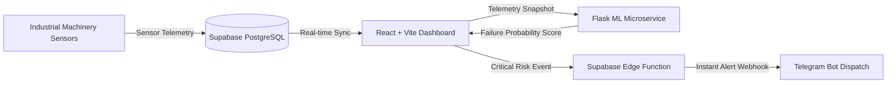

# ⚙️ EquipAware

> **Industrial IoT Equipment Health Monitoring & Predictive Maintenance Platform**

[](https://react.dev/)
[](https://tailwindcss.com/)
[](https://supabase.com/)
[](https://python.org/)
[](LICENSE)

---

## 📌 Overview

**EquipAware** is an Industrial Internet of Things (IIoT) monitoring and predictive maintenance platform engineered to eliminate unplanned machinery downtime.

By synthesizing real-time telemetry (vibration, operating temperature, multi-axis sensors, duty cycles) with a predictive machine learning scoring engine, EquipAware continuously monitors machinery health, visualizes live status metrics on a sleek operations dashboard, and triggers automated Telegram alerts when failure risks exceed safety thresholds.

---

## 🏗️ System Architecture



---

## 🚀 Key Features

- **Real-Time Telemetry Dashboard:** Modern UI displaying active machines, temperature, vibration indices, and operational status (`Operational`, `Warning`, `Critical`).
- **Predictive Failure Scoring:** Python/Flask inference engine evaluating multi-parameter degradation curves to calculate remaining useful life and failure probabilities.
- **Role-Based Auth & Access:** Built-in authentication (Login, Password Reset, Operator Sessions) powered by Supabase Auth.
- **PostgreSQL Telemetry Ledger:** Time-series tables tracking machine inventories, continuous telemetry readings, and historical prediction logs.
- **Automated Incident Alerts:** Serverless Edge Function integration to dispatch instant alert notifications to plant operators via Telegram when failure probability exceeds 70%.

---

## 📂 Project Structure

```
equipaware/
├── src/
│   ├── components/
│   │   ├── EquipmentOverview.tsx     # Machinery catalog & status cards
│   │   ├── PerformanceMetrics.tsx    # Live telemetry data visualization
│   │   ├── PredictiveMaintenance.tsx # Machine learning risk prediction panel
│   │   └── StatusBadge.tsx           # Health badge indicator
│   ├── pages/
│   │   ├── Dashboard.tsx             # Main operations command center
│   │   ├── Login.tsx                 # Supabase authentication page
│   │   └── ChangePassword.tsx        # Password management
│   ├── supabase.ts                   # Supabase client initialization
│   ├── types.ts                      # TypeScript data interfaces
│   ├── App.tsx                       # React Router configuration
│   └── main.tsx                      # Frontend application entry point
├── ml/
│   └── app.py                        # Flask ML failure risk prediction microservice
├── sql/
│   └── schema.sql                    # PostgreSQL database schema (machines, sensors, predictions)
├── supabase/
│   └── functions/
│       └── send-telegram/            # Edge function for automated alert notifications
├── package.json                      # Frontend dependencies & scripts
├── tailwind.config.js                # Tailwind CSS styling configuration
├── vite.config.ts                    # Vite build configuration
└── README.md                         # Project documentation
```

---

## 🗄️ Database Schema (`sql/schema.sql`)

- **`machines`**: Registry of plant machinery (`id`, `name`, `location`).
- **`sensor_readings`**: High-frequency telemetry log (`machine_id`, `sensor1`, `sensor2`, `temperature`, `vibration`, `timestamp`).
- **`predictions`**: AI risk inference records (`machine_id`, `failure_risk`, `predicted_on`).

---

## ⚡ Quick Start & Installation

### 1. Prerequisites
- **Node.js:** v18.0.0 or later
- **Python:** 3.10 or later
- **Supabase Account:** Free project setup on [supabase.com](https://supabase.com/)

### 2. Frontend Setup
```bash
# Clone the repository
git clone https://github.com/<your-username>/equipaware.git
cd equipaware

# Install npm dependencies
npm install

# Configure environment variables
# Create a .env file in the root directory:
```
```env
VITE_SUPABASE_URL=https://<your-project-id>.supabase.co
VITE_SUPABASE_ANON_KEY=<your-supabase-anon-key>
```

```bash
# Start the Vite development server
npm run dev
```
Open `http://localhost:5173` in your browser.

### 3. Run the ML Predictive Microservice
In a separate terminal:
```bash
cd ml

# Install microservice dependencies
pip install flask

# Start the inference server
python app.py
```
The ML API will run on `http://127.0.0.1:5000/predict`.

---

## 📡 Predictive ML API

**Endpoint:** `POST /predict`

**Request Payload:**
```json
{
  "sensor1": 45.2,
  "sensor2": 78.1,
  "temperature": 92.5,
  "vibration": 14.8,
  "operating_hours": 3200
}
```

**Response:**
```json
{
  "failure_risk": 0.81,
  "predicted_failure": true
}
```

---

## 📱 Telegram Alert Integration

When failure risk exceeds safe operational thresholds:
1. The dashboard invokes the Supabase Edge Function `send-telegram`.
2. The function triggers the Telegram Bot API:
   ```
   🚨 High risk detected for Hydraulic Press C2! Immediate inspection required.
   ```

---

## 📄 License

This project is licensed under the [MIT License](LICENSE).
